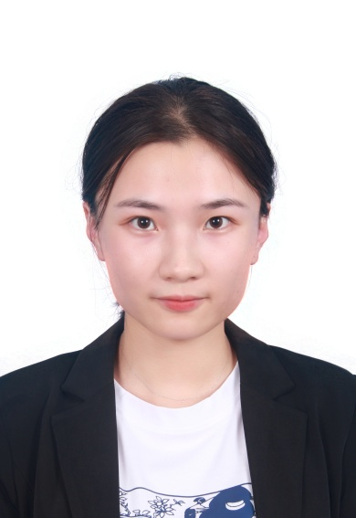

<!doctype html>
<html lang="en"><head><meta charset="utf-8"><meta name="viewport" content="width=device-width, initial-scale=1"><title>Wenqi Zhao | Mathematical Modeling and Machine Learning</title><meta name="description" content="Wenqi Zhao — research in mathematical modeling, machine learning, and biomedical data."><link rel="canonical" href="https://zwq1999212.github.io/"><link rel="icon" href="/images/favicon.ico"></head><body>

<header class="top"><a class="brand" href="/">Wenqi Zhao</a><nav aria-label="Main navigation"><a class="active" href="/" aria-current="page">Home</a><a href="/research/">Research</a><a href="https://zwq1999212.github.io/publications/" target="_blank" rel="noopener noreferrer">Publications</a><a href="https://zwq1999212.github.io/assets/CV_Wenqi_2026-11-15.pdf" target="_blank" rel="noopener noreferrer">CV</a></nav></header>

<aside><h1>Wenqi Zhao</h1>
Research Assistant University of Wisconsin–Madison

<a href="mailto:zwq@stu.cqu.edu.cn">Email</a><a href="https://scholar.google.com/citations?user=UwtVtOQAAAAJ" target="_blank" rel="noopener noreferrer">Google Scholar</a><a href="https://github.com/zwq1999212" target="_blank" rel="noopener noreferrer">GitHub</a>
</aside>
<main>

I am a research assistant in Prof. Yang Lu’s group at the University of Wisconsin–Madison, working on representation learning for biomedical data. I also collaborate with Prof. Xiaofeng Yang at the University of Chicago on medical AI.

My research interests include mathematical modeling and machine learning, with applications in medical imaging and biomedical data analysis. My current work focuses on representation learning for high-dimensional data, particularly relationships between samples and features.

I am seeking <strong>PhD opportunities starting in Fall 2027.</strong> Please feel free to <a href="mailto:zwq@stu.cqu.edu.cn">contact me</a> if you think my background could be a good fit for your group.

<a class="cv" href="https://zwq1999212.github.io/assets/CV_Wenqi_2026-11-15.pdf" target="_blank" rel="noopener noreferrer">CV (PDF) ↗</a>
<section id="wenqi-research" aria-label="Selected research">

<h2>Selected Research</h2>

<article><h3>Representation Learning for Biomedical Data</h3>
Developing methods to represent relationships between samples and features in high-dimensional biomedical data.

Ongoing research with Prof. Yang Lu
</article>
<article><h3>Variational Methods for Medical Image Analysis</h3>
Mathematical models for image segmentation and bias-field correction, using structural priors to address intensity inhomogeneity.

<a href="https://zwq1999212.github.io/assets/PR.pdf" target="_blank" rel="noopener noreferrer">RefLSM · PDF ↗</a><a href="https://zwq1999212.github.io/assets/Robust%20image%20segmentation%20and%20bias%20field%20correction%20model%20based%20on%20image.pdf" target="_blank" rel="noopener noreferrer">ESWA · PDF ↗</a>
</article>
<article><h3>SAVeR-Med</h3>
Evidence-governed evaluation and claim calibration for adaptive medical AI experimentation.

Research with Prof. Xiaofeng Yang
</article>
</section>
</main>

<footer>© 2026 Wenqi Zhao</footer>

</body></html>
