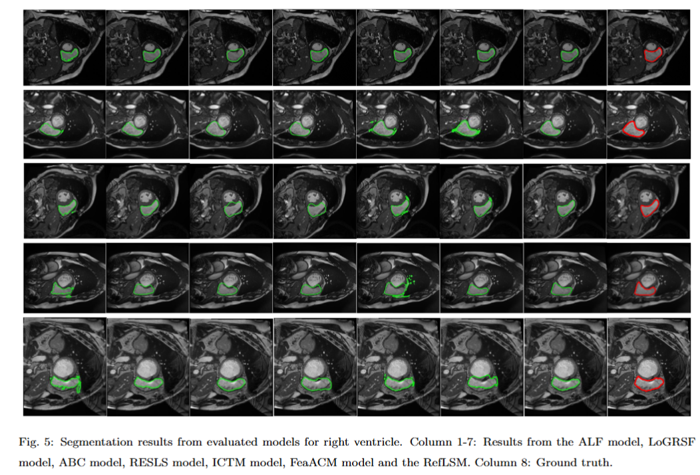
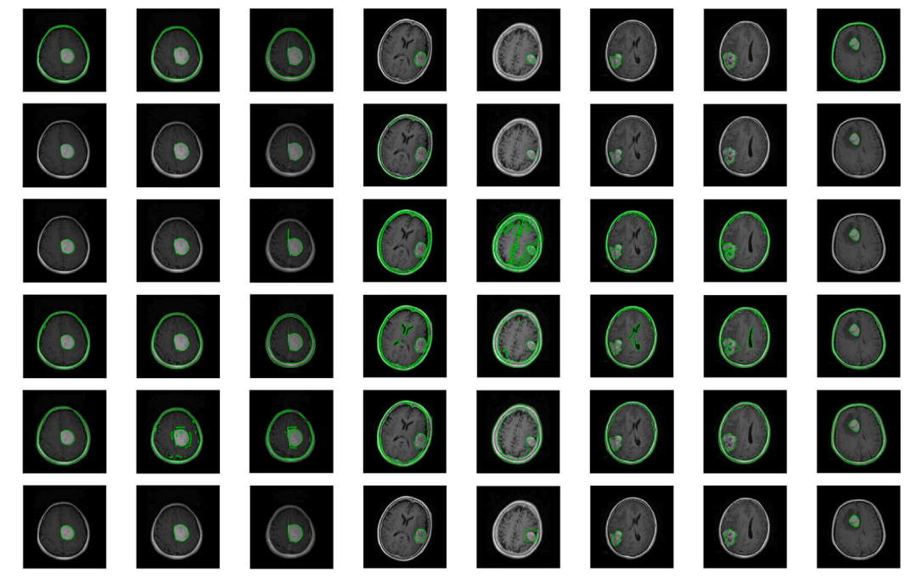

<h2>Representation Learning for Biomedical Data</h2>

Developing methods to represent relationships between samples and features in high-dimensional biomedical data.

<em>Ongoing research with Prof. Yang Lu.</em>

<h2>SAVeR-Med</h2>

Evidence-governed evaluation and claim calibration for adaptive medical AI experimentation.

<em>Research with Prof. Xiaofeng Yang.</em>

 
<h3>AI Agents for Medicine: A Comprehensive Review of Architectures,
Cognitive Modules, and Clinical Workflows</h3>

    I led a comprehensive review on medical AI agents, defining a new taxonomy for cognitive architectures and mapping components to clinical workflows.

    <strong>[ 
        <a href="/assets/preprint.pdf" target="_blank" rel="noopener noreferrer">
            PDF
        </a> 
    ]</strong>

    <em>Submitted to Medical Image Analysis (2025).</em>

 <h3>RefLSM: Linearized Structural-Prior Reflectance Model for Medical Image
Segmentation and Bias-Field Correction</h3>

    This paper presents RefLSM, a novel model that directly segments the illumination-invariant reflectance of an image, using a new linear structural prior to ensure robust segmentation in noisy, low-contrast medical scenes.

    <strong>[ 
        <a href="/assets/PR.pdf" target="_blank" rel="noopener noreferrer">
            PDF
        </a> 
    ]</strong>

    <em> Pattern Recognition (under review) (2025).</em>

<h3>Robust image segmentation and bias field correction model based on image structural prior constraint</h3>

    I proposed an innovative variational model with spatial structural priors, and validated its robustness on diverse medical and synthetic images via extensive comparative experiments.

    <strong>[ <a href="https://zwq1999212.github.io/assets/Robust%20image%20segmentation%20and%20bias%20field%20correction%20model%20based%20on%20image.pdf" target="_blank">Published Paper</a> ]</strong>
    &nbsp;&nbsp;
    <em>Published in Expert Systems with Applications (2024).</em>

